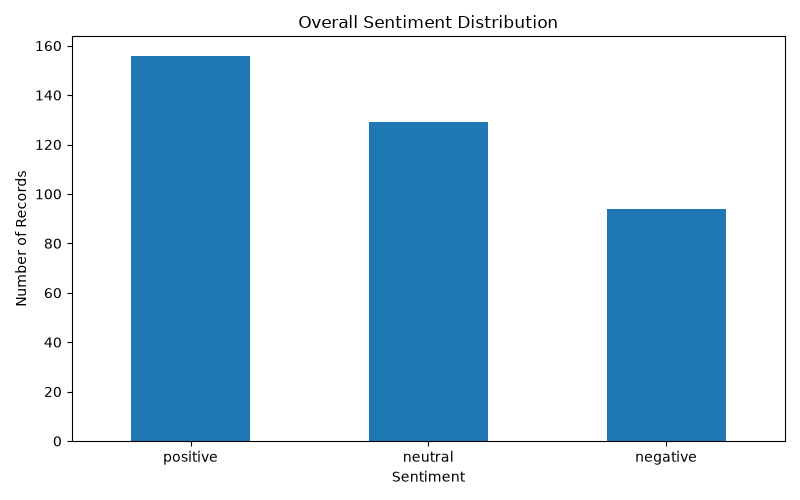
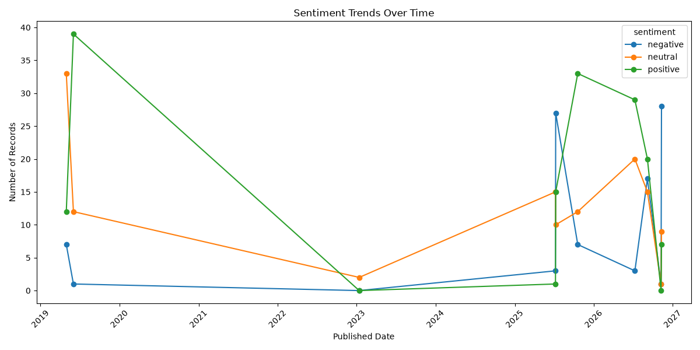
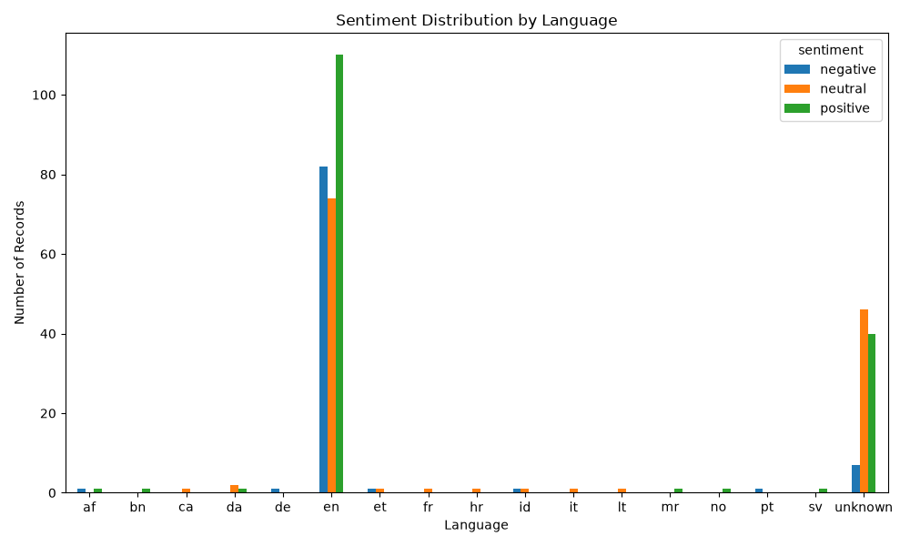
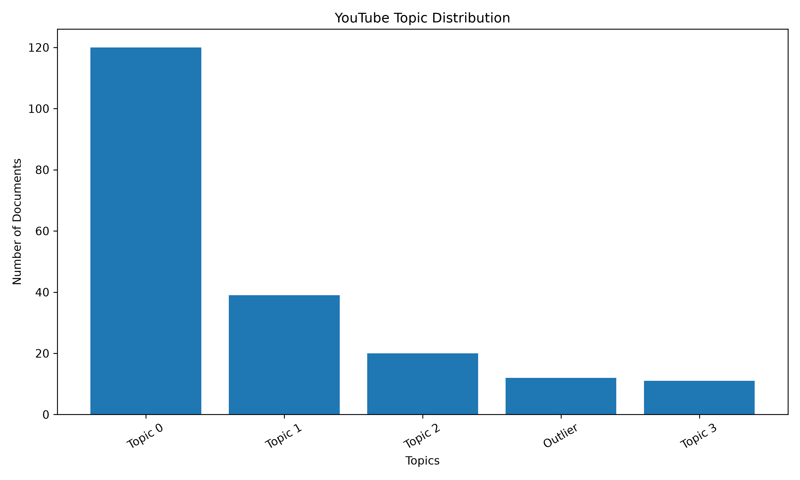
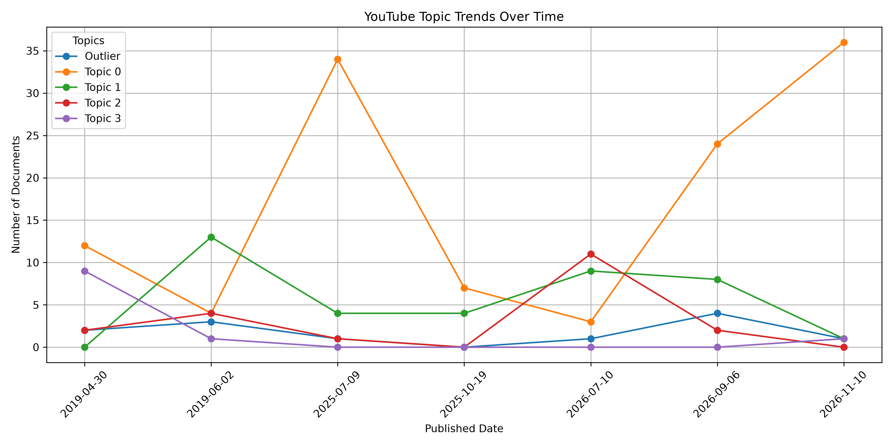
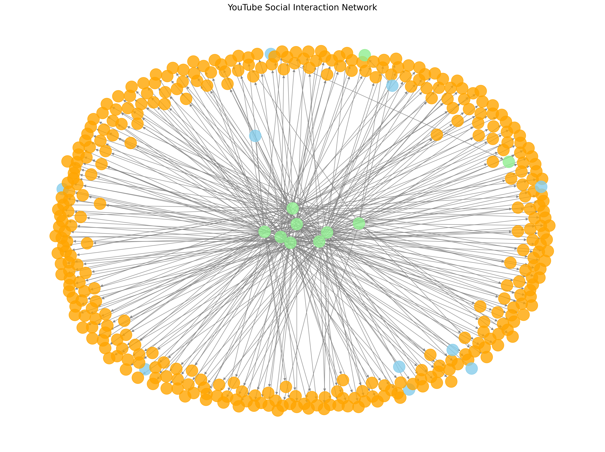
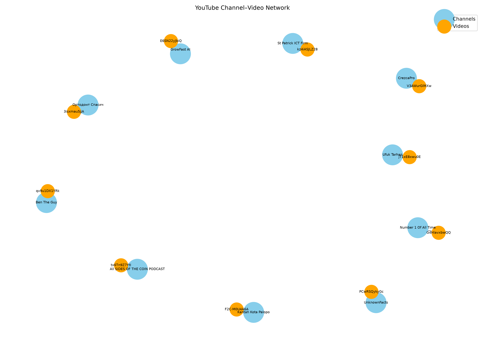

# Social Media Intelligence Platform

An end-to-end Python-based Social Media Intelligence Platform that analyzes YouTube videos and audience comments using Natural Language Processing (NLP), sentiment analysis, topic modeling, graph analytics, and Neo4j.

## 1. Project Overview

This project aims to understand YouTube audience discussions, identify public sentiment, discover trending topics, and analyze social interaction networks.

The platform combines data collection, text analytics, network analysis, and graph database technology to generate meaningful insights from social media data.

## 2. Project Objectives

- Collect YouTube video and comment data.
- Clean and preprocess collected text.
- Perform sentiment analysis.
- Discover discussion topics using topic modeling.
- Analyze topic trends over time.
- Construct social interaction networks.
- Identify important nodes using graph centrality.
- Detect communities in social networks.
- Store and explore graph relationships using Neo4j.
- Generate analytical reports and visualizations.

## 3. Key Features

1. YouTube Data Collection
2. Text Preprocessing
3. Sentiment Analysis
4. Topic Modeling
5. Topic Trend Analysis
6. Social Interaction Graph Construction
7. NetworkX Graph Analytics
8. Static Graph Visualization
9. Interactive Graph Visualization
10. Neo4j Database Integration

## 4. Technology Stack

| Category | Technologies |
|---|---|
| Programming Language | Python |
| Data Processing | Pandas, NumPy |
| Machine Learning | Scikit-learn |
| Natural Language Processing | NLP |
| Sentiment Analysis | Sentiment Analysis |
| Topic Modeling | Topic Modeling |
| Graph Analytics | NetworkX |
| Graph Database | Neo4j |
| Visualization | Matplotlib, Plotly |
| Interactive Graphs | Vis Network |
| Data Storage | CSV, GraphML |
| Version Control | Git, GitHub |

## 5. Project Architecture

The project follows this workflow:

YouTube Data Collection
        ↓
Text Preprocessing
        ↓
Sentiment Analysis
        ↓
Topic Modeling
        ↓
Topic Trend Analysis
        ↓
Social Interaction Graph Construction
        ↓
Graph Analytics using NetworkX
        ↓
Graph Visualization
        ↓
Neo4j Database Integration
        ↓
Analytical Reports

For more details, see:

`docs/ARCHITECTURE.md`

## 6. Project Results

### Social Interaction Graph Statistics

| Metric | Result |
|---|---:|
| YouTube Channels | 10 |
| YouTube Videos | 10 |
| Commenters | 342 |
| Total Nodes | 362 |
| Total Relationships | 352 |
| Detected Communities | 10 |

### Graph Structure

The constructed directed graph contains:

- Channel → Video (`PUBLISHES`)
- Video → Commenter (`HAS_COMMENTER`)

### Graph Analytics Techniques

- Degree Centrality
- PageRank
- Community Detection
- Node Type Distribution
- Social Network Structure Analysis

Note: These results describe only the collected dataset. They do not represent all YouTube users or platform-wide engagement.

## 7. Project Visualizations

### Sentiment Distribution



### Sentiment Over Time



### Sentiment by Language



### Topic Distribution



### Topic Trends Over Time



### Social Interaction Network



### Channel and Video Network



## 8. Neo4j Integration

The generated social interaction graph was successfully imported into Neo4j.

Import summary:

- 362 nodes imported.
- 352 relationships imported.
- Database constraints created successfully.
- Graph relationships stored and explored using Cypher.

## 9. Project Structure

```text
social-media-intelligence-platform/
│
├── dashboards/
│
├── data/
│   └── processed/
│
├── docs/
│   ├── ARCHITECTURE.md
│   └── GRAPH_ANALYTICS_REPORT.md
│
├── lib/
│
├── reports/
│   └── graph_visualizations/
│
├── src/
│   ├── graph/
│   ├── ingestion/
│   ├── misinformation/
│   ├── preprocessing/
│   ├── search/
│   ├── sentiment/
│   └── topics/
│
├── tests/
│
├── neo4j_importer.py
├── requirements.txt
├── inspect_topics.py
├── test_comments.py
├── test_neo4j.py
└── README.md